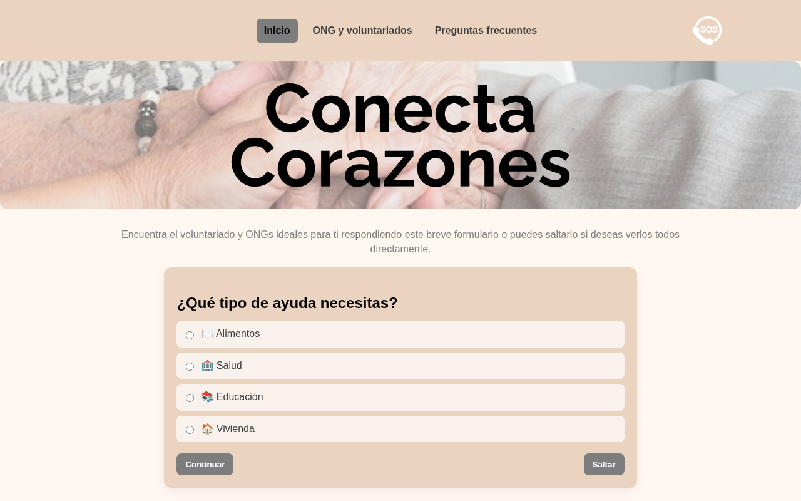
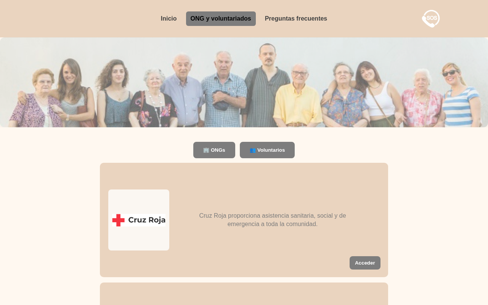

# Conecta Corazones

Quien necesita ayuda para comer, para ir al médico o para tener un techo muchas veces no sabe a qué puerta llamar. Hay muchísimas ONG, cada una se dedica a una cosa, y encontrar la que te toca no es fácil cuando ya vas justo de fuerzas.

Conecta Corazones quiere ser el paso anterior: una web que te pregunta qué necesitas y te dice a quién acudir.

Se puede probar en [conectacorazones.vercel.app](https://conectacorazones.vercel.app).



## Cómo funciona

La portada es un formulario de una sola pregunta: ¿qué tipo de ayuda necesitas? Hay cuatro respuestas: alimentos, salud, educación o vivienda. Al continuar llegas a una lista de organizaciones recomendadas, cada una con una frase que explica a qué se dedica. Quien prefiera verlas todas puede saltarse el formulario.

La web no da ayuda ni dinero. Solo hace de puente entre la persona y la organización.

Arriba a la derecha hay siempre un botón SOS que lleva a los teléfonos de emergencia de España, por si lo que hace falta no puede esperar.



## En qué punto está

Es un prototipo de la interfaz. Ya están la navegación entre páginas, el formulario, las fichas de las ONG, las preguntas frecuentes y el botón SOS.

Faltan tres cosas:

- La lista recomendada es la misma elijas lo que elijas. La respuesta del formulario llega a la página, pero todavía no se usa para filtrar.
- El botón "Acceder" de cada ficha solo muestra un aviso. No hay contacto real con la organización.
- Los botones "ONGs" y "Voluntarios" se marcan, pero no cambian la lista.

## Con qué está hecha

HTML, CSS y JavaScript, sin frameworks ni dependencias. Son cuatro páginas, una hoja de estilos y un script. Está publicada en Vercel.

## Verla en local

```bash
git clone https://github.com/Valentin-Penna/ConectaCorazonesRepository.git
```

Después abre `index.html` en el navegador. No hay nada que instalar ni que compilar.

Los logotipos de las ONG pertenecen a cada organización y se usan solo para identificarlas.
